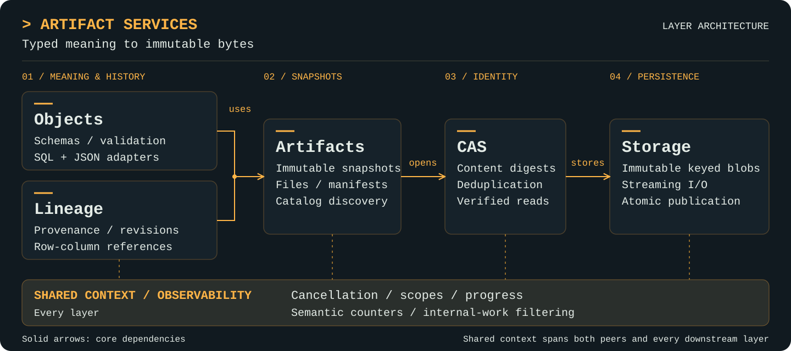

<picture>
  <source media="(prefers-color-scheme: dark)" srcset="docs/assets/craggy-wordmark-on-dark.svg">
  
</picture>

# Artifact Services

A streaming Go library for immutable content, artifact snapshots, typed objects,
and provenance. Small interfaces keep physical storage separate from content
identity, typed meaning, and revision histories. Context carries cancellation and
shared observation across operations.

All seven layers have Go implementations with explicit resource and backend limits. Objects,
lineage and assertions sit over artifacts; artifacts builds on CAS, which builds on storage.
Optional [adapters](docs/adapters.md) add wiring, run coordination, typed access, tree I/O, GC,
journal watching and read-only SQL. See the layer guides for supported subsets and
[verification evidence](docs/verification.md) for qualification limits.

## Features

- **Immutable content:** [stream blobs atomically](docs/storage.md) and [deduplicate by SHA-256](docs/cas.md), with streamed read integrity established at EOF.
- **Discoverable snapshots:** [publish files and collections](docs/artifacts.md), filter catalog metadata, and page through fixed query snapshots with explicit limits.
- **Typed data and bounded queries:** [define table/JSON schemas](docs/objects.md), pin immutable schema versions, and query with a supported SQL subset or JSON Pointer; capabilities and provenance coverage are explicit.
- **Independent histories:** [record generic provenance and revisions](docs/lineage.md), including explicit row/column mappings and bounded traversal across derivations.
- **Assertions with authority:** [record typed statements](docs/assertions.md) about stored things, with derived current views, keyed uniqueness and capability-restricted writers.
- **Crash recovery by reopening:** [commits are flushed before success is reported](docs/durability.md), a dead owner cannot block a root, and composite operations converge when rerun.
- **Shared observation:** [carry context across layers](docs/observability.md), report semantic progress and counters, and keep internal work out of default reporting while retaining diagnostic access.

## Layer architecture

<p align="center">
  <a href="docs/assets/artifact-services-architecture.svg">
    
  </a>
</p>

Solid arrows point to domain dependencies; the shared context band spans all
layers. Higher-level coordination composes
Objects publication and lineage recording, without making either peer depend on
the other for storage. Objects owns schema and selector semantics; lineage carries
generic references and mapping evidence. Catalog discovery finds snapshots;
Objects adapters query their content.

| Layer | Responsibilities | Guide |
| --- | --- | --- |
| Storage | Immutable keyed blobs, streaming I/O and atomic publication. | [Storage](docs/storage.md) |
| Observability | Context scopes, progress, semantic counters and internal-work filtering. | [Observability](docs/observability.md) |
| CAS | Content identity, deduplication and verified streaming reads. | [CAS](docs/cas.md) |
| Artifacts | Immutable manifests, file access and catalog discovery. | [Artifacts](docs/artifacts.md) |
| Objects | Runtime schemas, typed validation and content-query adapters. | [Objects](docs/objects.md) |
| Lineage | Generic activities, independent revisions and row/column provenance. | [Lineage](docs/lineage.md) |
| Assertions | Typed statements about stored things, current views and writer authority. | [Assertions](docs/assertions.md) |

Start with the [documentation index](docs/README.md), the
[runnable storage/observation example](docs/observability.md#examples), or the
[runnable end-to-end walkthrough](docs/walkthrough.md).

For coding-agent integration and repository development guidance, see [AGENTS.md](AGENTS.md).

## Development

Requires Go 1.27 or newer. The core has no external dependencies; `adapters/sqlindex` is a
separate module with its own.

```sh
go test ./...
go test -race ./...
go vet ./...
go build ./...
```

See [verification and measurements](docs/verification.md) for crash qualification, Windows
failure coverage, the opt-in large trials, and their limitations.
