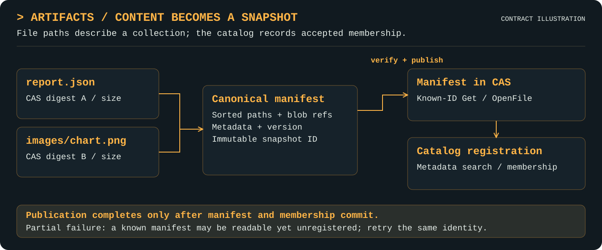

# Artifacts

[Project](../README.md) · [Documentation index](README.md) · [Walkthrough](walkthrough.md)

Available Go API. Artifact catalogs use an exclusive filesystem journal root and
rebuildable, synchronous in-process projections; they are not a distributed database.

## Purpose

Publish immutable single-file or collection snapshots, retrieve known files, and
discover registered snapshots through bounded typed catalog queries.

## Features

- Publish immutable single-file or collection snapshots with canonical manifests, logical paths, metadata, and reusable CAS references.
- Verify referenced content and sizes before publication; distinguish manifest availability from accepted catalog membership on partial failure.
- Discover snapshots by exact ID or accepted schema ID, file/byte bounds, and configured metadata equality filters.
- Page file listings and catalog searches over fixed snapshots with query-bound, expiring cursors and explicit resource limits.
- Rebuild catalog projections from an authoritative local journal; hide Internal support snapshots by default and opt into diagnostic discovery.
- Accept validated type claims only through the Objects publication seam; ordinary metadata cannot manufacture validated type status.

## Mental model

A canonical manifest identifies a snapshot. Its entries reference reusable CAS
content, while the journal records acceptance into this catalog. Manifest bytes can
exist without catalog registration after a partial failure; neither implies a revision.

<p align="center">
  <a href="assets/artifacts-features.svg">
    
  </a>
</p>

A readable manifest and accepted catalog membership are separate commit outcomes.

## Responsibilities and boundaries

`Manifest` has Version, Entries and Metadata. Each Entry has Path, Kind, Mode, and the
fields of its kind: Content and Size for a file, nothing for an explicit directory,
Target and an optional TargetPath for a link embedding another snapshot. Publish verifies each referenced CAS stream through EOF, checks its size,
canonicalizes the manifest and publishes it through CAS, then registers membership.
The complete collection is accepted only after both manifest and registration commit.
Payloads are not held in RAM. A manifest is stored as a root object over sorted blocks of
entries, so opening one file reads one block and listing pages through blocks.

Version 0 on publication selects version 1. Stored manifests carry
`ManifestVersion`, sorted unique path entries, and canonical JSON metadata: sorted object
keys, exact normalized decimal numbers and deterministic JSON string escaping. Duplicate
metadata object members, unsupported versions and noncanonical manifests encountered
by Get are rejected. IDs use the canonical root's `sha256:<hex>` CAS identity. Metadata,
modes and kinds affect snapshot identity; input entry order and equivalent numeric JSON
spellings do not. Get returns an independent manifest value.

Paths are case-sensitive logical names, not filesystem extraction instructions.
Absolute paths, empty/dot/traversal segments, backslashes, colons, NUL, invalid UTF-8,
and names over 4096 bytes are rejected. Metadata is limited to 256 keys (each at most
256 bytes) and 1 MiB. Sizes are nonnegative; summed logical size must fit int64.

`Options` sets the other limits: `MaxEntries` per manifest (default 100,000,000),
`MaxMaterializedEntries` for `Get`, the one call that holds a whole entry list (default
100,000; ListFiles and OpenFile are unaffected), `MaxManifestBytes` for the root object
(at most 8 MiB), `MaxLinkDepth` (default 16), and `MaxRecords` and `MaxBytes` for the journal.

Build large trees with `NewBuilder`: `Add` entries in any order, then `Publish`. It sorts
through temporary files, so heap stays flat however many entries there are.
`BuilderOptions.VerifyContent` checks each entry's size against stored content as it goes.

## Public interfaces

- `New(blobs cas.Store, options Options) (*Service, error)`
- `ParseID(value string) (ID, error)`
- `Publish(ctx context.Context, manifest Manifest) (ID, error)`
- `Get(ctx context.Context, id ID) (Manifest, error)`
- `OpenFile(ctx context.Context, id ID, path string) (io.ReadCloser, error)`
- `ListFiles(ctx context.Context, id ID, query FileQuery) (FilePage, error)`
- `Search(ctx context.Context, query CatalogQuery) (CatalogPage, error)`
- `Category(ctx context.Context, id ID) (observability.Category, error)`
- `Rebuild(ctx context.Context) error`
- `Close() error`
- `NewBuilder(options BuilderOptions) *Builder`
- `Stat(ctx, id, path) (FileInfo, error)`, `StatContent(ctx, cas.ID) (int64, error)`
- `OpenSeekable(ctx, id, path) (cas.SeekableFile, error)`
- `RecordOccurrence(ctx, OccurrenceRequest) (Occurrence, error)`, `GetOccurrence(ctx, OccurrenceID) (Occurrence, error)`, `Occurrences(ctx, OccurrenceQuery) (OccurrencePage, error)`
- `Sequence(ctx) (uint64, error)`, `OnCommit(func(uint64)) (stop func())`, `Changes(ctx, provenance.ChangeQuery) (provenance.ChangePage, error)`
- `Fence(ctx, func(context.Context) error) error`, `Reachable(ctx, func(cas.ID) error) error`

`Store` is the replaceable interface over the read, publish, search, stat and occurrence
methods. Category resolves authoritative registered classification without scanning
the catalog; an unregistered manifest returns ErrNotFound even if Get can read it. `Options` chooses Root and IndexedMetadata. Call Close to release the
exclusive catalog lease; it does not close already-returned readers or the shared CAS.

## Working with other layers

Artifacts depends on [CAS](cas.md), not Objects or lineage. It captures the caller's
explicit category before marking manifest verification/publication work Internal.
A user artifact therefore remains discoverable even though its supporting manifest
I/O is hidden from ordinary events and metrics. Entries opened for consumption retain
the caller's category. Every operation carries context and emits its own semantic span.

Ordinary Publish rejects every `objects.*` metadata key. The module-private typed
publication seam is `Service.PublishValidated(ctx, manifest, typedclaim.Claim)`;
only a valid sealed claim issued by the module's Objects coordinator is accepted.
It verifies source/schema artifact existence and requires the typed manifest entries
to equal the claimed source's entries. It inserts the exact objects.schema,
objects.data, objects.validator and objects.encoding values itself.

`Service.ValidatedClaim(ctx, id)` reads accepted claim information from registered
membership and checks it against the immutable manifest. Raw CAS metadata, even a
canonical manifest claiming a schema, does not create accepted type status. The
claim type is in an internal package and is not an uploaded-validator sandbox;
the Objects coordinator remains responsible for actual schema/data validation.
Previously accepted claims may be replayed only for the same bound data/schema/
validator/encoding. Exact-schema catalog filters consult accepted registration.

## Examples

```go
package example

import (
    "context"
    "errors"
    "path/filepath"
    "strings"

    "github.com/craggy-io/artifact-services/artifacts"
    "github.com/craggy-io/artifact-services/cas"
    "github.com/craggy-io/artifact-services/storage"
)

func PublishFile(root string) (id artifacts.ID, err error) {
    physical, err := storage.NewFilesystem(filepath.Join(root, "blobs"))
    if err != nil { return "", err }
    content, err := cas.New(physical, cas.Options{})
    if err != nil { return "", err }
    snapshots, err := artifacts.New(content, artifacts.Options{Root: filepath.Join(root, "catalog")})
    if err != nil { return "", err }
    defer func() { err = errors.Join(err, snapshots.Close()) }()
    ctx := context.Background()
    blob, err := content.Put(ctx, strings.NewReader("hello"))
    if err != nil { return "", err }
    return snapshots.Publish(ctx, artifacts.Manifest{Entries: []artifacts.Entry{
        {Path: "hello.txt", Content: blob.ID, Size: blob.Size},
    }})
}
```

Objects and [lineage](lineage.md) add typed meaning and histories over these snapshots;
content equality alone does not establish provenance.

## Semantics, errors, and limits

Every failed Publish returns a `*PublishError` retaining its cause. ID identifies the
intended canonical manifest; ManifestCommitted indicates established manifest
availability, and Registered indicates acceptance of this requested registration.
A CAS staging-cleanup failure can return both booleans true plus an error. A later
registration failure returns the ID with ManifestCommitted=true, Registered=false;
retrying the same manifest/classification completes registration without changing
identity. Get can retrieve canonical known-ID manifests regardless of membership.
Errors retain underlying CAS/storage/OS causes for errors.Is/errors.As. Missing files
return ErrNotFound; typed metadata without registration is ErrUnvalidated.
Operations after Close match ErrClosed; invalid/expired/mismatched cursors match
ErrCursor (and ErrInvalidQuery); snapshot-capacity failures match ErrLimit.

Registration is immutable and idempotent. Reusing the same ID with a different
category or accepted claim is ErrConflict. Internal snapshots are omitted by default
from Search; IncludeInternal selects both. Known-ID reads still work for internal
artifacts. This is reporting, not access control or deletion. Get/OpenFile inherit CAS
integrity semantics: full successful EOF verifies content; early Close does not.
OpenFile tracks actual reads and finishes on Close, including errors; repeated Close
is idempotent and reads afterward return io.ErrClosedPipe. Returned readers
require serial Read/Close calls, like the underlying CAS readers.

FileQuery selects a normalized whole-directory Prefix, Limit and Cursor. `dir` and
`dir/` normalize identically; neither matches `directory/`. Entries are sorted by
UTF-8 path bytes. CatalogQuery filters exact ID/SchemaID, inclusive MinFiles/MaxFiles
and MinBytes/MaxBytes pointer bounds, ANDed Metadata equality, and IncludeInternal.
Configured metadata values support strings up to 256 bytes, booleans, and int64;
comparison is typed, case-sensitive and exact. Null/arrays/objects, coercion, nested
queries and unconfigured metadata filters are errors. At most 16 indexed keys may
be configured, fixed by the persisted root policy; changing policy on reopen errors.
A new root/migration can apply a different policy, verifying its publications anew.

Pages default to 100 and reject limits outside 1–1000 (zero selects default). Results
are fixed snapshots, with opaque query-bound replayable cursors expiring 15 minutes
from creation. Changing any normalized filter or limit errors. Cache quotas are
16 MiB per snapshot, 64 MiB total and 128 active sessions; exceeding them errors.
Returned pages are independent copies. Cursors belong to one live Service and do
not survive Close/reopen. Rebuild retains existing snapshots while atomically replacing
its derived catalog; new queries see all committed registrations at capture time.

Journal records are authoritative, bounded by default to 20,000,000 records and 64 GiB.
The resident state is a key index and offsets, not record values. Catalog projections are
replayed and checked against CAS manifests on New/Rebuild. A failed rebuild leaves the
previous projection intact. Publication appends its immutable record and updates the
projection in one critical section, so there is no asynchronous index lag or silent stale
fresh-query mode. Queries use the projection, not an unbounded walk over payloads.
Cross-layer transactional snapshots are not promised.

The filesystem root is exclusively leased to one live Service; a dead owner's lease
disappears with it. See [durability](durability.md) for the commit points, fsync policy and
recovery. Roots must be trusted. Cancellation is checked before operations and while
verifying payloads; arbitrary blocked reads and filesystem commits cannot be forcibly
interrupted. No committed manifest/registration is rolled back because later cancellation
or cleanup failed.

## Occurrences

A snapshot's ID comes from its content, so publishing identical bytes twice gives one ID,
and that keeps retries idempotent. An `Occurrence` is the separate record of one naming of
a snapshot: stable caller ID, Name, Origin, Producer and Metadata, none of which affect the
content hash. Two occurrences of equal bytes list independently, and assertions and lineage
on one never appear on the other. `Occurrences` with `Content` finds every occurrence of
some content, `Artifact` finds those of a snapshot, and `Name` and indexed `Metadata` filter.
An identical retry returns the existing occurrence; different content under the same ID is
ErrConflict, and `OccurrenceError.Committed` reports the stage.

## Seekable access

`OpenSeekable` returns a file that supports Seek and ReadAt, for backends that implement
`storage.Seekable`. It hashes the whole file before returning, so the cost is one full read
at open, and corruption fails the open. It does **not** re-verify later reads: a change to
the stored file after open goes undetected. Backends without the capability return
`cas.ErrCapability`; use [`spool`](adapters.md#spool) there.
`Stat` reports size, mode and content without opening anything.

## Validation and evidence

Focused tests cover canonical identity, complete payload verification, corruption,
size/path/metadata bounds, stable paging during appends, cursor replay/filter binding,
classification defaults/conflicts, typed-claim spoof rejection and source binding,
reopen/rebuild, exclusive policy roots, reader lifecycle, concurrent idempotent writes,
cancellation, committed CAS cleanup errors and registration-failure recovery.

See [verification](verification.md) for integrated evidence, including the 1,000,000-entry
tree trial and crash qualification. Disk-full, hard-link failure and physical power loss are
not qualified.
