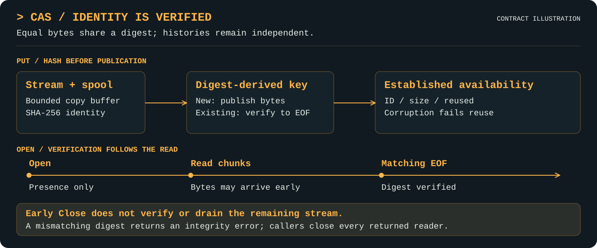

# CAS

[Project](../README.md) · [Documentation index](README.md) · [Walkthrough](walkthrough.md)

Available Go API. SHA-256 is the supported content-identity algorithm.

## Purpose

Give immutable bytes a verified content identity through a streaming interface.

## Features

- Address content with canonical SHA-256 identities, hashing streams through disk staging with a bounded copy buffer.
- Deduplicate identical content only after verifying the existing bytes, including concurrent publication races.
- Verify streamed reads at matching EOF; opening, existence checks, and early close do not establish integrity.
- Return content ID, size, and reuse status, with explicit committed-with-error outcomes and preserved underlying errors.
- Propagate context and report CAS-specific publication, reuse, and verification counters.

## Mental model

Equal bytes can share a digest without sharing artifact identity, revisions, or
history. A successful full read verifies the digest; opening a stream alone does not.

<p align="center">
  <a href="assets/cas-features.svg">
    
  </a>
</p>

Write identity and read verification are separate steps; early close leaves the read unverified.

## Responsibilities and boundaries

`cas.ID` is `sha256:` followed by exactly 64 lowercase hexadecimal digits. ParseID
validates the supported algorithm and canonical spelling. The backing storage key
is the hexadecimal digest, with no filename or artifact metadata interpretation.

Put consumes and hashes a source stream into a private temporary file, then asks
storage to publish those complete bytes. Its working copy buffer is bounded; the
payload is not retained in RAM. `Options.MaxBytes` optionally caps one Put's size
(`ErrLimit` when exceeded; zero means unlimited, so untrusted streams should set it
or be wrapped with `io.LimitReader`). `Options.TempDir` chooses staging; empty uses the
OS temporary directory. New resolves a supplied relative path without creating
files/directories. The configured staging directory must already exist and be writable.
Staging files are closed/removed on success and failure; cleanup errors are returned.

`PutResult` contains `ID`, `Size int64`, and `Reused bool`. Normal duplicate writes
succeed only after reading the existing blob through verified EOF, including when
another writer wins the publication race. Existing corruption is an error and is
never overwritten or silently reused. Extra errors accompanying already-exists
(such as backend cleanup failure) are preserved even if reuse verifies successfully.

CAS does not provide filenames, revisions, search, or provenance. Identical bytes
are not evidence that the same history or activity was used.

## Public interfaces

- `New(blobs storage.Store, options Options) (*Service, error)`
- `ParseID(value string) (ID, error)`
- `Put(ctx context.Context, source io.Reader) (PutResult, error)`
- `Open(ctx context.Context, id ID) (io.ReadCloser, error)`
- `Exists(ctx context.Context, id ID) (bool, error)`
- `OpenSeekable(ctx, id) (SeekableFile, error)`: hashes the whole file before returning. Later reads are not re-verified. Requires a seekable backend, or returns `ErrCapability`
- `Stat(ctx, id) (int64, error)`: size without opening, checking presence and not integrity. Requires a backend with `Stat`, or returns `ErrCapability`

The last three methods form `cas.Store`, implemented by Service. Operations are
safe for concurrent use; individual returned readers require serial Read/Close.

## Working with other layers

CAS builds on [storage](storage.md). Artifact manifests can reference its content;
digest lookup is separate from [catalog search](queries.md#digest-access-and-artifact-discovery).
Shared observation uses `cas/put`, `cas/open`, and `cas/exists` scopes and propagates
parent context and explicit classification unchanged to child storage operations.

Put counts bytes consumed from its source once, with `published` or `reused` semantic
counters after successful availability. Open counts actual stream bytes and reports
`verified` only after matching EOF, then `closed` or `unverified_close` on Close.
A reuse check is a real nested Open scope; do not sum per-layer/per-operation byte
counts as unique payload or physical disk I/O. Internal classification/filtering and
inclusive parent duration follow [observability](observability.md).

## Examples

```go
package example

import (
    "context"
    "io"
    "strings"

    "github.com/craggy-io/artifact-services/cas"
    "github.com/craggy-io/artifact-services/storage"
)

func CASRoundTrip(ctx context.Context, root string, output io.Writer) (cas.ID, error) {
    backend, err := storage.NewFilesystem(root)
    if err != nil { return "", err }
    content, err := cas.New(backend, cas.Options{})
    if err != nil { return "", err }
    result, err := content.Put(ctx, strings.NewReader("hello"))
    if err != nil { return result.ID, err }
    reader, err := content.Open(ctx, result.ID)
    if err != nil { return result.ID, err }
    _, readErr := io.Copy(output, reader) // Read through EOF to verify identity.
    closeErr := reader.Close()
    if readErr != nil { return result.ID, readErr }
    return result.ID, closeErr
}
```

For committed-with-error writes, inspect the outer `*cas.PutError` with errors.As;
do not treat a returned ID by itself as proof that content became available.

## Semantics, errors, and limits

- Every failed Put wraps its cause in `*cas.PutError{Committed, Err}`. Committed
  means this operation established verified content availability through new
  publication or verified reuse. An ID/size can be known before publication, so a
  nonempty result alone is insufficient. Nested source errors do not determine
  this call's committed flag. Original causes remain accessible with errors.Is/As.
- Once content publishes, a backend/staging close or cleanup error does not roll
  it back. Put returns its stable ID and Committed=true. Reused remains true for
  verified preexisting content even if its reader subsequently fails to close.
- Open hashes bytes as they are read. Matching EOF completes verification;
  mismatch returns `ErrIntegrity` instead of successful EOF, potentially alongside
  final bytes. Bytes may be delivered before verification, so callers needing
  verified content before use must stage it themselves. Early Close does not drain
  or verify the remaining bytes. Exists checks presence only, not integrity.
- Read errors/EOF are terminal for the CAS reader. Repeated Read returns the same
  terminal error; repeated Close returns the cached underlying close error and
  finalizes observation once. Reads after Close return io.ErrClosedPipe. Close
  does not repeat a read-integrity error; final observation retains it.
- Invalid/unsupported IDs match ErrInvalidID. Missing content and backend/OS errors
  retain the storage error contract. Put never closes the caller's source reader.
- Cancellation is checked before operations and around source/backend reads.
  It cannot forcibly interrupt arbitrary blocked readers, filesystem calls, or
  underlying publication. Storage's atomic-publication boundary remains authoritative:
  cancellation racing that boundary can still leave committed content.
- Staging can require temporary disk space in addition to storage's temporary copy.
  Process termination can leave staging files, which nothing reads again. There is no
  quota service or stronger durability guarantee than the underlying storage backend; see
  [durability](durability.md). Roots/content must remain trusted and immutable.

## Validation and evidence

Focused Go tests, race checks and vet pass on Windows. Tests cover empty/binary
roundtrips, verified reuse, concurrent same-content publication, malformed IDs,
missing blobs, corruption on Open/reuse, source errors/cancellation, published and
staging-cleanup failures, duplicate-plus-cleanup error preservation, final-byte EOF,
early close, repeat close, and explicit internal observation. An 8 MiB generated
stream verifies bounded read chunking without a whole-payload input buffer.
Cleanup failure injection is package-private; filesystem disk-full/sync failures are not
qualified. Process-kill behaviour is covered by [crash qualification](verification.md#crash-qualification). The [1 GiB storage baseline](verification.md)
is not itself a CAS throughput or memory measurement; a separate CAS-over-storage
1 GiB trial (`TestLargeCAS1GiB`) is documented alongside it in
[verification](verification.md).
