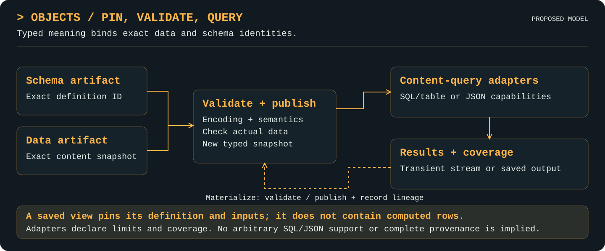

# Objects

[Project](../README.md) · [Documentation index](README.md) · [Walkthrough](walkthrough.md)

Initial Go API available for bounded table/JSON validation and content queries. The feature summary below describes the implemented subset; design illustrations remain conceptual.

## Purpose

Attach runtime-defined types and validated content-query semantics to immutable snapshots.

## Features

The implemented subset is summarized here; the contracts below define exact supported behavior and limits.

- Define runtime table and JSON schemas as immutable artifacts, with stable table column IDs and bounded shape/constraint validation; schema changes create new artifacts rather than rewriting old definitions.
- Validate pinned data/schema identities and publish a new typed snapshot bound to its encoding and validator semantics.
- Query tables with the bounded `sql-v1` subset: SELECT, equality INNER JOIN, comparison/AND filters, arithmetic, GROUP BY, COUNT, and SUM; unsupported SQL is rejected.
- Query JSON with `json-pointer-v1`; this reports document dependencies, not table row/column provenance or arbitrary JSONPath support.
- Expose capability and provenance coverage explicitly, with configurable row, byte, join, group, result, and dependency limits; early result closure cannot claim complete coverage.
- Save views with exact inputs, or materialize SQL table results into validated snapshots and mapping artifacts; callers coordinate the separate lineage records.

## Mental model

Schema and data are pinned immutable artifacts; a type label alone is not validation.

<p align="center">
  <a href="assets/objects-features.svg">
    
  </a>
</p>

Materialized results re-enter validation and publication; saved views retain definitions and pinned inputs. Lineage record creation remains the caller’s coordinated step.

## Responsibilities and boundaries

Objects validates runtime declarative schemas and immutable data, then issues typed
publication through the module-private `internal/typedclaim` capability. Ordinary
artifact Publish rejects all `objects.*` metadata. Accepted claims are looked up
from durable artifact registration and bind exact source/schema IDs, encoding, and
`objects-validator-v1`; raw CAS bytes with forged metadata are never accepted.
This capability protects the public library boundary, not malicious code executing
inside this module or a hostile process able to rewrite its trusted filesystem.

Objects and lineage are peers over artifacts. Objects does not execute lineage
records, assign histories, or verify that a supplied history ID exists. Lineage
validates that revision-to-artifact binding and calls Objects `ValidateRef` to check
actual row/column membership. No circular package dependency is required.

### Schemas and data

`SchemaDefinition{Version: SchemaVersion, Model: Table|JSON}` is stored in a
`schema.json` artifact. `SchemaVersion` is `objects-schema-v1`. Table columns have
stable `ID`, display `Name`, `Shape`, and optional `Unique`; JSON uses a recursive
`Shape`. Names are case-insensitive SQL identifiers, but evidence always carries
stable column IDs. Renaming a display name creates a new immutable schema artifact;
it does not invent a mapping between revisions.

Supported shapes are string, signed 64-bit integer, finite number, boolean, object,
and array. Constraints include Nullable, required object properties, recursive
properties/items, numeric Minimum/Maximum, string/array MaxLength, and typed Enum.
Unknown object properties and unknown/missing table columns are rejected. Numeric
bounds are binary64 configuration values compared against exact input numbers;
integer data is never rounded to binary64 for bound comparison. Schema definitions
are validated, including enum-member type compatibility, before publication.

Table encoding `ndjson-rows-v1` contains one JSON record per line:

```json
{"id":"row-17","values":{"region_id":"west","amount_id":12}}
```

Row IDs are explicit, nonempty, unique within the snapshot and at most 256 bytes.
Values are keyed by stable column IDs, not display names or row offsets. Every
column is present; Nullable allows its value to be null. Unique compares canonical
JSON values, including null. Validation streams rows but retains bounded row-ID and
uniqueness sets. JSON encoding `json-v1` validates one bounded complete document.
No executable validators, arbitrary schema vocabulary, or disk-backed unbounded
constraint execution are accepted.

`ValidationRequest` pins Data, Schema, and Encoding. `ValidationReport` binds those
identities and validator version, counts rows, and reports validity/coverage/issues.
Validation fails rather than skipping an unsupported constraint or exceeded limit.
Publish always performs validation itself; a caller-provided report cannot bypass it.
It publishes a new typed manifest over the same entry bytes and exact schema pin.
Existing data/schema artifacts remain unchanged through evolution or migration.

### Query adapters and evidence

`sql-v1` is a bounded in-process evaluator, not a claim of full SQL compatibility.
It supports SELECT expressions with explicit output aliases, FROM pinned input
aliases, INNER JOIN (or JOIN) with equality/AND column predicates, WHERE scalar
comparisons joined by AND, GROUP BY, COUNT and SUM. Arithmetic supports +, -, *, /
and unary signs; parameters use `:name`. Scalar comparisons support =, !=, <>, <,
>, <= and >=. Null comparisons do not pass a filter; SUM ignores null values and
COUNT(expression) counts nonnull values. COUNT(*) counts matching tuples. Nonaggregate
columns in aggregate expressions must occur in GROUP BY. No implicit query engine,
UDF, subquery, OR, DISTINCT, ORDER BY, wildcard SELECT, or mutation statement exists;
unsupported syntax is rejected rather than delegated opaquely.

Arithmetic/comparisons preserve exact integer/decimal values. Division is accepted
only when its exact result terminates within 32 decimal places; nonterminating
results are explicitly unsupported. Table joins/aggregation load bounded validated
inputs into memory; results are bounded and computed before ResultStream is returned.
The public stream yields one ResultRow at a time and isolates returned values from
internal state, but this is not an out-of-core SQL engine.

`json-pointer-v1` selects a value from one typed JSON document with JSON Pointer
escaping (`~0`, `~1`) and bounded array indices. It reports an exact document input
reference, not table row/column lineage. RequireComplete rejects that adapter when
complete detailed row/column coverage is requested. It is not JSONPath or a general
JSON query language.

Query inputs carry exact artifact and revision IDs; unresolved latest labels are
rejected as absent pins, and any external latest-name resolution must happen before
calling Objects. The coordinator must verify supplied nonempty revision identifiers
through lineage. Query parameters and inputs are copied/canonicalized before use.
Saved views pin these definitions through SaveView/GetView without materializing rows;
query execution remains the point where expression resolution and result validity
are checked. There is no mutable view replacement API.

For supported SQL, ResultRow exposes stable generated ID, Values, row/cell Dependencies,
per-output Columns dependencies, and Expressions. Output IDs hash the pinned query
and exact alias-qualified contributing row identities/group values, not row offsets
or display names alone. Joins produce many-to-many evidence; aggregates retain all
contributing group inputs. Value, predicate, and grouping-control dependencies are
separate roles. Completeness means **positive emitted-result dependencies** under
this evaluator: it does not explain why rejected rows are absent, negative provenance,
or arbitrary counterfactual changes. Opaque/unsupported operations fail explicitly.

Materialize streams bounded results into a temporary table, validates against the
supplied output schema (output aliases must match its stable IDs), publishes a typed
snapshot, and writes an Internal NDJSON mapping artifact. It emits row-only, cell,
and column-only mappings; column mappings union actual source-column dependencies
and preserve expression text. It does not require an enormous public lineage record.
The caller reserves OutputRevision, then registers that output revision after
publication and before registering activity/evidence with lineage. The reserved ID
is not a claim that Objects created a history record. A/B histories remain separate
from C’s own revision chain even when their artifacts contain identical bytes.

## Public interfaces

- `New(blobs cas.Store, store *artifacts.Service, options Options) (*Service, error)`
- `DefineSchema(ctx context.Context, definition SchemaDefinition) (artifacts.ID, error)`
- `GetSchema(ctx context.Context, id artifacts.ID) (SchemaDefinition, error)`
- `Validate(ctx context.Context, request ValidationRequest) (ValidationReport, error)`
- `Publish(ctx context.Context, request PublishRequest) (artifacts.ID, error)`
- `ValidateRef(ctx context.Context, ref provenance.Ref) error`
- `Query(ctx context.Context, request QueryRequest) (ResultStream, error)`
- `Capabilities(ctx context.Context) (Capabilities, error)`
- `SaveView(ctx context.Context, request QueryRequest) (artifacts.ID, error)`
- `GetView(ctx context.Context, id artifacts.ID) (QueryRequest, error)`
- `Materialize(ctx context.Context, request MaterializeRequest) (Materialized, error)`
- `(ResultStream).Next() (ResultRow, error)`
- `(ResultStream).Coverage() provenance.Coverage`
- `(ResultStream).Close() error`

## Working with other layers

[Artifacts](artifacts.md) provides immutable data/schema snapshots and accepted type
claims. [CAS](cas.md) verifies referenced bytes. [Lineage](lineage.md) owns independent
histories and validates version-qualified selector bindings. Objects imports only
neutral `provenance` references, not lineage. All operations carry context and
[observability](observability.md); schema reads, validation/persistence support and
mapping publication run as Internal work, while user schemas and typed outputs can
remain user-visible. A catalog query discovers typed artifact IDs; SQL/JSON adapters
interpret selected contents separately from [catalog search](queries.md).

## Examples

Given `service` from New, `typedA`/`typedB` accepted table artifacts, and previously
validated lineage revision IDs A-1/B-1:

```go
stream, err := service.Query(ctx, objects.QueryRequest{
    Language: objects.SQL,
    Text: "SELECT a.region AS region, SUM(a.amount + b.amount) AS total " +
        "FROM a INNER JOIN b ON a.region = b.region GROUP BY a.region",
    Inputs: []objects.Input{
        {Alias: "a", Artifact: typedA, Revision: "A-1"},
        {Alias: "b", Artifact: typedB, Revision: "B-1"},
    },
    RequireComplete: true,
})
if err != nil { return err }
for {
    row, err := stream.Next()
    if err == io.EOF { break }
    if err != nil { stream.Close(); return err }
    _ = row.Values
    _ = row.Dependencies // exact history-qualified value/predicate/control refs
}
coverage := stream.Coverage() // complete only after successful EOF
_ = coverage
return stream.Close()
```

See [walkthrough](walkthrough.md) and `integration/system_test.go` for schema evolution,
independent input/output histories, materialization and bounded provenance queries.

## Semantics, errors, and limits

Default Options bound each input to 100,000 rows/64 MiB, each NDJSON row to 1 MiB,
results to 10,000 rows, join candidate work to 1,000,000 pairs, groups to 10,000,
and total returned dependency entries to 1,000,000. Up to eight pinned inputs and
256 columns are supported. Schema definitions are capped at 64 KiB, 32 nesting levels
and 2,048 shape nodes. Query text is capped at 64 KiB/8,192 tokens, normalized query
requests at 1 MiB. Limits can be lowered/raised via Options with corresponding memory
cost; exhausting them returns ErrLimit, never a truncated result claiming completeness.
Materialization bounds table/evidence bytes by MaxBytes and a single evidence row
by the internal 16 MiB read bound. Mapping records also obey provenance's 10,000-input
bound. Large joins therefore may fail explicitly even when their input files fit.

Context is checked between reads, joins, groups and outputs; blocking underlying
I/O is not forcibly interrupted. ResultStream is serial-use, Close is idempotent,
and reads after Close fail. Coverage is incomplete before EOF, after an error, or
on early Close; final query observation occurs at Close. Materialization requires
successful full consumption and exact output-schema validation.

Errors preserve underlying causes. ErrSchema distinguishes invalid definitions,
ErrValidation invalid data/refs, ErrQuery invalid requests, ErrUnsupported unsupported
semantics, and ErrLimit quota failures. PublicationError retains content/artifact IDs
and commitment/registration flags for supporting file publication errors.
MaterializeError embeds the partial Materialized result and underlying cause;
ArtifactRegistered/EvidenceRegistered distinguish known IDs from accepted registrations.
A later mapping/cleanup failure does not roll back an already published typed output.
Missing/failed evidence publication cannot claim complete materialization coverage.
No cross-layer transaction or automatic deletion is implied.

## Validation and evidence

`go test -race ./objects` covers definition/enum compatibility, nested JSON constraints,
nulls/unknown columns/unique row IDs, numeric bounds and arithmetic beyond 2^53,
many-to-many joins/groups and exact input histories, predicate/control evidence,
unsupported SQL/UDFs, resource limits/cancellation/early close, JSON Pointer coverage,
view pins, row/cell/column mapping publication, selector validation, reserved-claim
rejection, temporary cleanup and committed output followed by evidence failure.
The root integration suite exercises all actual layers together. No out-of-core SQL,
why-not provenance, arbitrary UDF coverage, crash recovery, disk-full qualification,
or large Objects-query benchmark is claimed. See [verification](verification.md).
