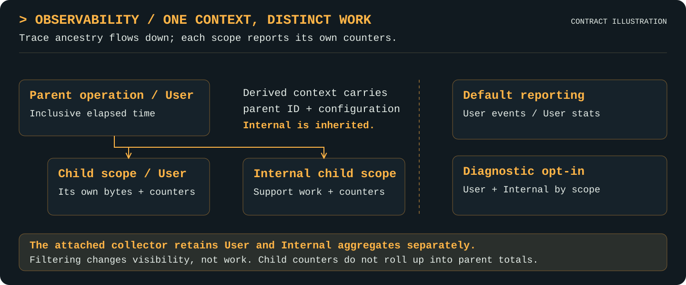

# Observability

[Project](../README.md) · [Documentation index](README.md) · [Walkthrough](walkthrough.md)

Available Go API.

## Purpose

Report explicit work across layers through a shared context.

## Features

- Attach reporting configuration to context and preserve parent/child scope ancestry across nested and concurrent operations.
- Report scoped progress, bytes, semantic counters, errors, and inclusive duration through callbacks and optional collectors.
- Classify support work as Internal, inherit that classification, and hide it from default events and statistics while allowing diagnostic opt-in.
- Retain separate User/Internal collector aggregates; keep each scope's counters independent instead of rolling child bytes into parent totals.
- Observe reader lifetimes through Close and use a no-op path when observation is disabled; metrics describe observed process work, not persistent inventory.

## Mental model

A context carries reporting configuration and trace ancestry; each span owns its own counters.

<p align="center">
  <a href="assets/observability-features.svg">
    
  </a>
</p>

Each scope owns its counters; filtering Internal work does not remove it from execution or parent duration.

## Responsibilities and boundaries

Observability depends only on Go's standard library. Each layer starts a scope,
passes its derived context to dependencies, and reports its own outcomes. For
example, storage publication, CAS reuse, artifact snapshot completion, and lineage
record acceptance are different semantic counters. Child bytes are not rolled up
into a parent's logical totals. A caller attaches configuration once; concurrent
children inherit it and retain parent-child links. Cancellation remains cooperative,
with commit boundaries decided by the owning layer; it is not a cross-layer rollback
transaction. The existing process-local metrics, callback, and reader-lifetime
[contracts](observability.md#semantics-errors-and-limits) apply to the shared facility, not to unimplemented domain behavior.

## Public interfaces

- `With(ctx context.Context, options Options) context.Context`
- `WithInternal(ctx context.Context) context.Context`
- `CategoryFrom(ctx context.Context) Category`
- `Start(ctx context.Context, scope Scope, key string) (context.Context, *Span)`
- `(*Span).AddBytes(n int64)`
- `(*Span).Count(name string, n int64)`
- `(*Span).RecordError(err error)`
- `(*Span).End(err error)`
- `(*Collector).Snapshot(options SnapshotOptions) map[Scope]Metrics`

## Working with other layers

Independent of storage and all domain packages. Each layer starts scopes and passes the derived context downward. It does not infer domain outcomes from child byte counts.

Persistence owners use `CategoryFrom(ctx)` to obtain the explicit User/Internal
category for record registration. Capture the operation's category before marking
its journal, manifest, validation, or index sub-operations Internal: supporting I/O
does not change the registered object's category. The accessor works even without
an observer/collector, so persisted classification never depends on telemetry being
enabled. It does not infer classification from keys, filenames, or content.

## Examples

```go
package example

import (
    "context"
    "io"
    "strings"
    "time"

    "github.com/craggy-io/artifact-services/observability"
    "github.com/craggy-io/artifact-services/storage"
)

func RoundTrip(root string, output io.Writer) error {
    backend, err := storage.NewFilesystem(root)
    if err != nil { return err }
    var metrics observability.Collector
    ctx := observability.With(context.Background(), observability.Options{
        Collector: &metrics,
        ProgressInterval: 100 * time.Millisecond,
        Observer: func(event observability.Event) {
            // Send to a concurrency-safe logger/UI queue if desired.
            // event.Final ends a scope; bytes alone do not prove publication.
        },
    })
    if err := backend.Put(ctx, "abcd0123", strings.NewReader("hello")); err != nil {
        return err
    }
    reader, err := backend.Open(ctx, "abcd0123")
    if err != nil { return err }
    _, readErr := io.Copy(output, reader)
    closeErr := reader.Close()
    _ = metrics.Snapshot(observability.SnapshotOptions{})
    if readErr != nil { return readErr }
    return closeErr
}
```

Each implemented layer starts its own scope and propagates the returned context.
For example, an application can group real storage calls without inventing CAS:

```go
ctx, operation := observability.Start(ctx,
    observability.Scope{Layer: "application", Operation: "upload"}, "request-id")
err := backend.Put(ctx, "abcd0123", source)
if err == nil { operation.Count("completed_uploads", 1) }
operation.End(err)
```

The storage span has the application span's ID as its ParentID. Derived contexts
(including cancellation/deadline contexts) inherit configuration and linkage.
Concurrent children started with the same parent context are siblings with unique
IDs. Parents do not automatically aggregate/end children or infer their semantic
outcomes. Higher layers report counters such as `published`/`reused` explicitly;
observation itself supplies no CAS or artifact functionality.

## Semantics, errors, and limits

### Classification

Direct storage operations default to `observability.User`. Mark support work with
`observability.WithInternal(ctx)` before starting it; all descendant spans inherit
`observability.Internal`, even across `With`, cancellation contexts, and concurrent
children. Classification is sticky: no API resets an internal descendant to User.
Start user-facing siblings from the original user context. This deliberate scoping
rule preserves trace/parent IDs without deriving meaning from storage keys.
`CategoryFrom(ctx)` returns User for an ordinary context and the inherited Internal
category after `WithInternal`; subsequent observation reconfiguration, cancellation,
or disabling observation does not reset that category. It is a read-only accessor,
not an authorization check or a way to override inherited Internal.

```go
// ctx already carries the collector/observer configured above.
internalCtx := observability.WithInternal(ctx)
// Any storage calls made with internalCtx now report internal work.
_ = internalCtx
visible := metrics.Snapshot(observability.SnapshotOptions{})
diagnostic := metrics.Snapshot(observability.SnapshotOptions{IncludeInternal: true})
_, _ = visible, diagnostic
```

Observer events exclude Internal by default. Set `Options.IncludeInternal: true`
when configuring observation to emit future diagnostic events. Every event carries
Category. Enabling it later does not replay previously filtered events or fabricate
missing parent events; parent IDs still describe the original trace.

An attached collector always retains separate User/Internal aggregate buckets,
including work whose events were filtered. `Snapshot(SnapshotOptions{})` excludes
Internal; `Snapshot(SnapshotOptions{IncludeInternal: true})` sums both buckets per
scope. The latter is a diagnostic work view, not a unique-user-payload view.
No data predating attachment, or from contexts with collection disabled, can be
recovered. Buckets store bounded scope/counter labels, not event histories or keys;
retained labels are capped (labels beyond the cap are dropped, so names must stay
bounded). `Collector.Reset` clears retained totals; otherwise collector lifetime
is controlled by the application.

Spans report their own work; child bytes/counters are never automatically summed
into user parents. Orchestration must count logical user payload/artifact outcomes
on the appropriate user scope and report support bytes on internal scopes, rather
than manually copying hidden bytes into a parent. Per-layer stream-byte metrics
are process work, not physical disk measurements; summing layers is not a unique
payload total. Parent elapsed time and metric Duration remain **inclusive** of
internal work. Parent errors remain visible even when caused by internal work.
Classification filters reporting only; it does not alter I/O, cancellation,
validation, publication, or error propagation. The matching [discovery policy](queries.md#default-discovery-classification)
is implemented by catalog and lineage discovery (internal work is excluded
unless `IncludeInternal` is set).

### Events and lifecycle

- `With` attaches options only to a context subtree; empty options disable
  observation there. Without observer/collector, `Start` returns the original
  context and a nil span without allocating a scope. All nil-span methods are
  no-ops. There is no global collector. Use non-nil contexts throughout.
- Observer and collector are independently optional. Collectors are zero-value
  usable and concurrency-safe; do not copy after use. Selected snapshots are independent
  copies keyed by `Scope{Layer, Operation}`, with started/completed/errors, bytes,
  summed inclusive completed duration, and named semantic counters. Active is started
  minus completed. Use bounded scope/counter labels; keys are not retained.
- Events carry ID/ParentID, scope/key, Category, cumulative bytes/counters, inclusive elapsed time,
  optional total, error, and Final. `Options.Total` may supply a size hint by
  scope/key; absent, negative, or unknown values become -1. Totals are not
  validated or converted to a fabricated percentage.
- Byte updates are throttled per span (default 100ms); selected start, semantic counts,
  recorded errors, and final updates always emit. No timer emits during idle I/O.
  End is idempotent; reporting after End does nothing. Span methods require
  serial calls; independent child spans may run concurrently.
- Callbacks run synchronously and may run concurrently across spans. They must
  not panic or reenter the same span/reader. They may inspect snapshots or start
  other spans; no collector lock is held during callbacks. Slow callbacks delay
  work and contribute to lifetime duration.
- Storage reports scopes `storage/put`, `storage/open`, and `storage/exists`.
  Put increments `published` only after actual publication, even if cleanup
  fails. Open increments `eof` once, `closed` once, and `early_closed` when closed
  without observing EOF. Errors count terminal failing operations, not error
  values. Bytes count consumed/transferred stream bytes, including `(n, err)`.
- Open spans include opening and the returned reader's lifetime. EOF/read errors
  produce updates; only Close finalizes, preserving close errors. Final errors
  join read/close errors; Close returns only its original close error. Repeated
  Close returns the cached error without closing/counting again; reads after
  Close return `io.ErrClosedPipe`. Individual readers require serial use.
  Abandoned readers remain active. Reading exactly a known size without asking
  for EOF still counts as early close.
- Metrics cover only explicit operations observed in this process. Child bytes
  are not rolled into parents. Layer totals must not be summed as unique bytes,
  logical dedup savings, disk I/O/allocation, or persistent/global inventory.

## Validation and evidence

See [verification](verification.md) for executable checks, Windows cases, and the measured 1 GiB baseline. That evidence qualifies current storage/observation behavior only.

Focused `go test -race ./observability`, `go vet ./observability`, and
`go build ./observability` passed after the registration-facing category accessor
was added. Tests verify classification before/after configuration, inherited and
canceled contexts, independent concurrent user/internal consumers, callback event
map isolation, filtered aggregation, and zero allocations for category lookup plus
disabled scope creation. These tests do not qualify unrelated domain persistence
or query implementations.
