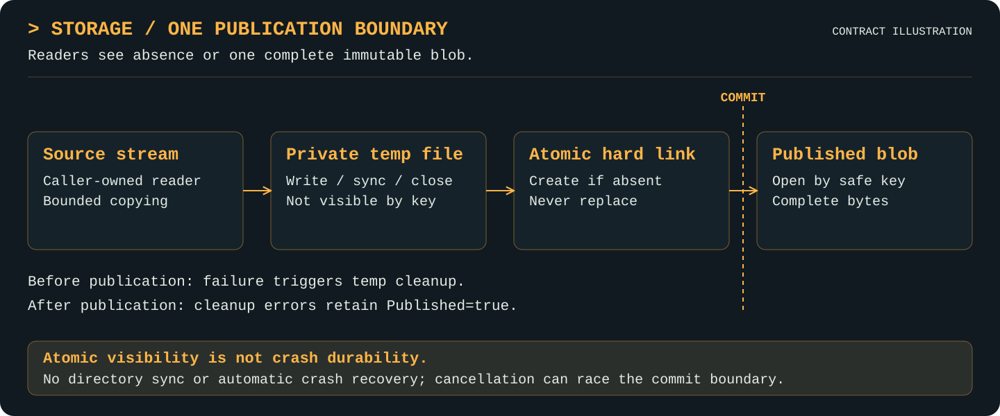

# Storage

[Project](../README.md) · [Documentation index](README.md) · [Walkthrough](walkthrough.md)

Available Go API.

## Purpose

Store opaque immutable blobs with a small streaming interface.

## Features

- Stream opaque blobs into temporary files, then sync, close, and publish atomically without replacing an existing key.
- Open complete immutable blobs by key and check existence without loading payloads into memory.
- Coordinate concurrent writers through the filesystem's create-if-absent hard link; one writer publishes each key.
- Preserve publication outcomes in errors, including cleanup failures after commit, with cooperative context cancellation.
- Use a local or mounted filesystem that supports atomic hard links; a successful Put is flushed, name included, before it returns. See [durability](durability.md).
- Open seekable files, stat blobs, and reclaim unreferenced ones through small optional interfaces.

## Mental model

A key names one complete blob; publication makes it visible atomically.

  

Filesystem publication boundary; cleanup errors after commit do not undo published bytes.

## Responsibilities and boundaries

`storage.Store` owns physical placement, streams, existence checks, and immutable
atomic publication. It accepts opaque safe keys, not filenames or content-identity
claims. CAS supplies digest-derived keys; storage neither hashes nor deduplicates
logically. The filesystem constructor chooses the root, including a mounted volume.
The detailed error, cancellation, and publication [contract](storage.md#semantics-errors-and-limits) remains authoritative.

## Public interfaces

- `NewFilesystem(root string) (*Filesystem, error)`
- `Put(ctx context.Context, key string, source io.Reader) error`
- `Open(ctx context.Context, key string) (io.ReadCloser, error)`
- `Exists(ctx context.Context, key string) (bool, error)`
- `ValidateKey(key string) error`: the key rule every implementation enforces

Optional capabilities, implemented by `Filesystem`, so other backends stay honest:

- `Seekable`: `OpenSeekable(ctx, key) (File, error)`, with Seek and ReadAt
- `Stater`: `Stat(ctx, key) (Info, error)`
- `Reclaimer`: `Walk`, `Remove(ctx, key, olderThan) (bool, error)`, `SweepPending(ctx, olderThan) (int, error)`

`Remove` deletes a blob only if it is older than the given time, and a repeat `Put` of an
existing key refreshes that time, so recently stored content is spared. Storage knows nothing
about what refers to a blob: [`gc`](adapters.md#gc) decides that. `SweepPending` clears
abandoned temporary files.

[`adapters/gcs`](adapters.md#gcs) is a second implementation, over a Google Cloud Storage
bucket, for stacks served by several processes. It implements `Stater` and `Reclaimer` but
not `Seekable`.

## Working with other layers

CAS supplies content-derived keys; storage reports its own work through [observability](observability.md). It does not interpret artifact meaning.

## Examples

The [runnable roundtrip](observability.md#examples) constructs the filesystem backend and calls Put/Open with context. The [walkthrough](walkthrough.md) separates those real operations from future layers.

## Semantics, errors, and limits

`Store` is replaceable and safe for concurrent operations. It owns physical layout
and publication, not hashing, identity validation, deduplication, or metadata.

- Keys are 2–128 ASCII lowercase hexadecimal characters. Other characters,
  separators, uppercase, and traversal return `ErrInvalidKey`. Layout is one file
  per blob at `<root>/<first-two>/<key>`; paths stay internal except diagnostics.
- Put never overwrites. Concurrent same-key writers have one publisher; losing
  completed writers return `ErrAlreadyExists`. A duplicate may consume its source.
- Every Put failure is wrapped in `*storage.PutError`, whose Published field
  describes this call. Use `errors.As` to inspect it and `errors.Is`/`errors.As`
  for retained source/OS errors. Nil means published. Cleanup failure after
  publication has Published=true; pre-publication failure has Published=false,
  even if an input error contains another operation's published PutError.
- Open returns `ErrNotFound` for missing blobs; Exists returns false, nil. Other
  errors propagate; non-regular entries are errors. Callers close returned readers;
  storage never closes supplied source readers.
- Writes stream into a temporary file, sync and close it, then atomically create
  a hard link without replacement. Readers see absence or complete data.
  Temporary cleanup runs on success/failure; cleanup errors retain other causes.
  Empty shards can remain. An empty deleted root is recreated by a subsequent Put.
- All operations check cancellation before filesystem work. Put also checks
  around stream reads, before writes/sync, and immediately before publication.
  Open retains its context in the reader and checks between reads. Cancellation
  cannot interrupt an arbitrary blocked reader, filesystem call, or Sync. A read
  that returns bytes as cancellation arrives still counts those bytes.
- Cancellation observed before publication prevents publication and triggers
  cleanup. Cancellation racing the final check/hard-link operation may still
  publish. Once published, it is not rolled back: success (or Published=true on
  cleanup failure) remains authoritative even if the context is now canceled.
  Close always releases resources despite cancellation; cancellation alone after
  the last read does not manufacture a Close error.

The root must be private/trusted; external edits, symlinks, and junctions are
unsupported. Deletion exists only through `Reclaimer`, with no lifecycle policy. A Docker-mounted root needs no
special code, but its filesystem must support atomic non-replacing hard links.
Unsupported filesystems return errors; there is no copy/overwrite fallback.
Relative roots are resolved when NewFilesystem is called; later working-directory
changes do not retarget the store. Independent processes sharing a root rely on
the filesystem's hard-link create-if-absent operation, not a process-local mutex.
A successful Put has synced the file and flushed its name; see [durability](durability.md)
for what that does and does not qualify. A crash can leave temporary files, which are never
visible as blobs.

## Validation and evidence

See [verification](verification.md) for executable checks, Windows cases, and the measured 1 GiB baseline. That evidence qualifies current storage/observation behavior only.

The storage integration audit additionally exercises six separate writer processes
publishing the same key: exactly one publishes, all other writers report an
unpublished PutError wrapping ErrAlreadyExists, the winning content remains complete,
and no temporary links remain. A relative-root test verifies constructor-time binding
after changing the working directory. Both passed with the Windows storage race suite;
the existing long-path, permission, cancellation and cleanup-outcome coverage remains.
These checks qualify the physical contract required by CAS, not CAS's separate
identity verification or logical deduplication behavior.
